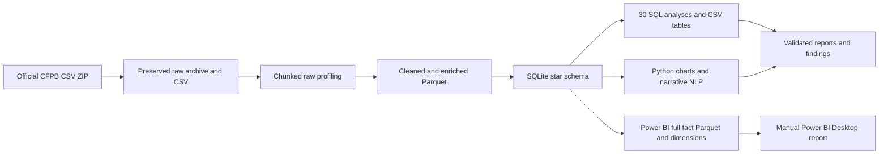

# Customer Complaint Intelligence Platform

Large-scale consumer finance analytics using Python, SQL, NLP, SQLite, and Power BI preparation.

## Overview

An end-to-end, reproducible analytics pipeline for the official Consumer Financial Protection Bureau (CFPB) Consumer Complaint Database. It downloads and preserves the official complete ZIP and CSV, profiles the raw data before transformations, cleans and enriches records, builds a dimensional SQLite model, runs business SQL, analyzes narrative text, produces charts, and exports a complete Power BI model. The final `.pbix` is created manually by the project owner.

## Business Problem

Understand complaint volume and change over time, product and issue mix, company response operations, state and submission channel patterns, narrative themes, and combinations that merit investigation. Complaint counts are workload signals that need context, not direct measures of company quality.

## Dataset

Source: [CFPB Consumer Complaint Database](https://www.consumerfinance.gov/data-research/consumer-complaints/). The pipeline downloads the current official CSV ZIP from CFPB and writes source URL, timestamp, file names, sizes, SHA-256 hashes, and source description to `data/raw/source_metadata.json`. Raw archive and extracted CSV are preserved unchanged and excluded from Git. The execution-derived dataset row count and date coverage are reported below after the first run.

> **Interpretation caution:** CFPB states that this database is not a statistical sample and is not necessarily representative of all consumers' experiences. Published complaints are subject to CFPB publication processes. Company and product complaint counts should not be treated as quality rankings without customer or market-share denominators; state counts need population context. See the [CFPB data notes](https://www.consumerfinance.gov/data-research/consumer-complaints/).

## Dataset Size

Generated from the completed pipeline in `outputs/reports/pipeline_run.json` and `outputs/reports/validation_report.txt`. Statistics are never hard-coded or fabricated.

## Architecture



## Tools & Technologies

Python 3.10+, pandas, NumPy, PyArrow/Parquet, scikit-learn TF-IDF and NMF, Matplotlib, SQLite, SQL window functions, Jupyter, Git, and Power BI Desktop.

## Data Pipeline

`python -m src.run_pipeline` runs download → raw profile → clean → engineer features → SQLite model → SQL analyses → Python EDA → narrative analysis → Power BI export → validation. `python -m src.download_data` refreshes/downloads the official source; `python -m src.inspect_data` profiles an existing raw CSV. Processing is chunked at 100,000 rows. The narrative corpus is capped at 150,000 records for practical NLP; core metrics and model exports use all cleaned records.

## Data Cleaning & Feature Engineering

Column labels become snake_case; surrounding whitespace is trimmed; empty values become null; yes/no flags and two-letter states are normalized; dates are parsed; ZIP codes and complaint IDs remain strings; invalid IDs and repeated complaint IDs are excluded; narratives are preserved except for surrounding whitespace. Date, calendar, response-time, timely flag, and narrative-presence/length/word-count features are added. `docs/DATA_QUALITY_REPORT.md` records the raw audit and `outputs/reports/validation_report.txt` records final integrity and reconciliation checks.

## SQL Analysis

Thirty saved SQLite analyses use joins, CTEs, CASE, ranks, LAG, cumulative and rolling windows, response measures, growth, and concentration. Results are in `outputs/tables/`; source SQL is in `sql/03_business_analyses.sql`.

## NLP Analysis

The full CFPB CSV in the current source release has no consumer narrative or consent field. The pipeline preserves these expected fields as null, reports zero published consumer narratives, and analyzes CFPB-published company public responses separately when text is available. TF-IDF unigrams/bigrams and eight-component NMF use a deterministic corpus cap of 150,000 text records (NMF fits at most 30,000). These are exploratory text groupings, not consumer sentiment or prevalence among complainants. Outputs are under `outputs/tables/` and `outputs/figures/`.

## Key Insights

See `docs/ANALYSIS_FINDINGS.md` after running the pipeline. It is generated from actual query results and includes period, segment, calculation, interpretation, and caveats.

## Power BI Dashboard Plan

Five pages: Executive Overview; Product & Issue Analysis; Company Performance; Geography & Channels; Narrative Intelligence. Import the complete Parquet fact and dimension CSVs in `data/powerbi/`, then follow `powerbi/POWER_BI_BUILD_GUIDE.md`. Relationships, DAX, visual specs, and interpretation cautions are in the other `powerbi/` guides. Open Power BI Desktop and build/save the final `.pbix` manually.

## Repository Structure

See `AGENTS.md` for the planned full layout. Main working areas are `src/`, `sql/`, `data/`, `database/`, `outputs/`, `powerbi/`, `docs/`, and `notebooks/`.

## How to Run

```powershell
python -m venv .venv
.\.venv\Scripts\Activate.ps1
python -m pip install -r requirements.txt
python -m src.run_pipeline
```

The pipeline needs an internet connection on first download and several GB of disk space for the full source, Parquet, SQLite, and exports. Re-runs reuse a valid local archive; delete `data/raw/complaints.csv.zip` to force a fresh download. Windows PowerShell is shown; the Python commands also work on macOS/Linux.

## Limitations

The published complaint database is not representative of all consumer experiences, excludes complaints that CFPB does not publish, and lacks customer counts needed to normalize company volumes. Narrative availability is selective. NLP is exploratory and capped. A complaint-level `date_sent_to_company - date_received` is used as a response-time proxy and may not capture the full operational timeline. Latest periods can be incomplete. Geography is not population-adjusted.

## Future Improvements

Join population and company market-share denominators, add time-aware completeness flags and privacy-reviewed drill-through, evaluate topic stability across refreshes, and automate Power BI refresh after selecting an organizational gateway/hosting approach.

## Screenshots

Add exported dashboard screenshots after building `Customer_Complaint_Intelligence.pbix` in Power BI Desktop.

## Author

Project portfolio — replace with author profile details before public presentation.
